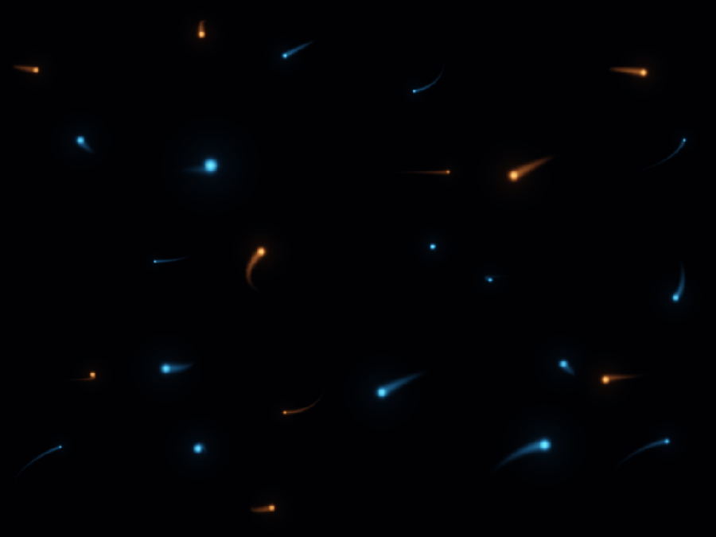

# Organic trails

A single-pass GLSL330 visual of cyan and amber particles on a dark background.
There are 26 particles distributed in a 6×5 grid with four empty cells. Each pixel
considers only nearby cells and uses up to eight continuous tapered segments per
trail. Paths are procedural, not persisted feedback or a stateful simulation.
The shader honors the renderer's globalColor.

## Run the native scene

From the repository root, pass [scene.vosc.json](scene.vosc.json) to a VOSC
binary that supports `--scene`.

```sh
vosc --scene examples/organic-trails/scene.vosc.json
```

The scene opens at 1024×768 and loads the fragment shader under `assets/` on one
stack layer with the four defaults below.

## Protected live authoring

For an eligible single-layer direct-source scene, submit `assets/organic-trails.frag`
and the four uniform defaults from [scene.vosc.json](scene.vosc.json) together with `trial_shader`.
Wait for `ready`, inspect a native preview, and explicitly `accept_trial`; use
`cancel_trial` when the candidate is not the intended visual. This protects the
retained shader and controls with the composed-scene GPU budget.

Use raw `publish_shader` only to bootstrap a known-cheap baseline when no eligible
direct-source shader exists. Raw `publish_shader`, `set_uniform`, and OSC changes
are unbudgeted compatibility bypasses. The protected budget does not cover CPU
compilation, media/update work, presentation, or GPU-hang preemption.

| Control | Default | Shader bounds |
| --- | --- | --- |
| motionSpeed | 0.65 | -2 to 2 |
| trailLength | 1.25 | 0 to 2.5 |
| brightness | 1.7 | 0 to 4 |
| coolTint | [0.16,0.62,1] | Each component 0 to 2 |

`motionSpeed` is used because `speed` is engine-managed. For protected revisions,
send control changes as `trial_shader` overrides with fresh request IDs. Setting `motionSpeed` to zero pauses the shader's motion but does not stop
frame rendering.

## Verify the shader on macOS

Build a disposable Debug renderer and run the protected authoring check from
the repository root. Both commands use a new private directory.

```bash
CHECK_DIR="$(mktemp -d /tmp/vosc-organic.XXXXXX)"
python3 scripts/build_macos_authoring.py --output "$CHECK_DIR/build"
python3 scripts/test_protected_authoring.py \
  --binary "$CHECK_DIR/build/products/voscDebug.app/Contents/MacOS/voscDebug" \
  --scene examples/organic-trails/scene.vosc.json \
  --output "$CHECK_DIR/evidence" --allow-reset
```

The runner owns the renderer and checks protected admission, preview, acceptance
and cancellation.

## Preview



The spatial shader reduced observed system GPU use from about 100% to 22–29%
while sustaining about 60 FPS in the same 1024×768 session. See the
[performance notes](Performance.md) for the workload and measurement limits.
